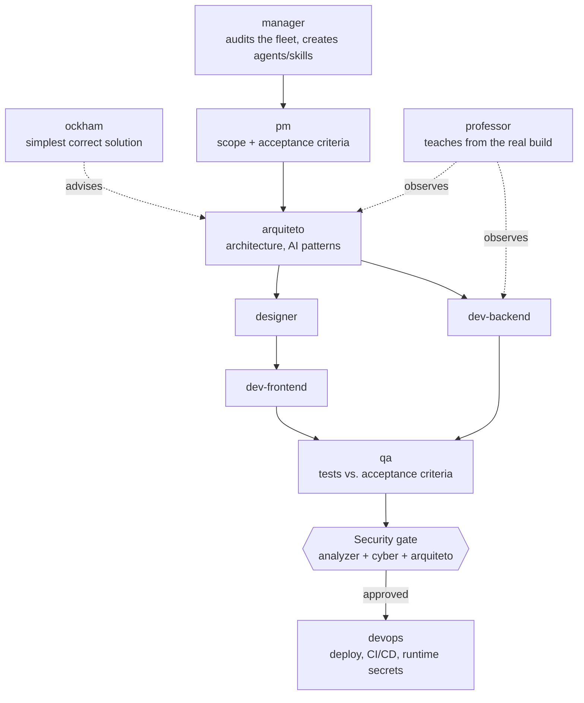

# claude-code-agent-fleet

> 17 specialized AI agents and 38 skills for Claude Code: a personal software house and tutor with a mandatory security gate.

## What it is

A **fleet of AI agents for [Claude Code](https://docs.claude.com/en/docs/claude-code)**
that I use as a personal "software house" and tutor: product, architecture,
backend, frontend, QA, DevOps, security, documentation and automation — plus a
teacher that turns real builds into programming, AI and cybersecurity lessons.

It is how I practice **programming with AI**: not one chat that does
everything, but agents with narrow responsibilities, explicit hand-offs and a
security gate nothing can skip.

## Why

A single general assistant tends to skip steps: it codes before the scope is
clear, tests after the fact and ships without a security review. Splitting the
work into roles with written rules makes the process repeatable, auditable and
much harder to cut corners on.

## Architecture

Supporting agents: `backlog` (activity log of what changed), `task` (what is
still missing and what blocks it), `docs` (step-by-step docs for beginners),
`automacoes` (scheduled routines and integrations), `pessoal` (email, calendar
and tasks — always asks before sending or deleting anything).

## Ground rules every agent follows

- **Grounding / no hallucination** — every fact cites a real source; unknowns
  are marked "to be confirmed", never guessed.
- **Evidence before verdict** — findings cite `file:line` or the actual command
  output.
- **Secrets never in chat or code** — referenced by location, never by value.
- **Three strikes** — if the same approach fails three times, change strategy.
- **"Does this already exist?"** — extend before creating; no duplicates.
- **AI transparency** — every bot identifies itself as an AI.

## Skills

| Group | What they cover |
|---|---|
| Teaching (21) | Programming logic, algorithms, web, databases, Git, LLMs, RAG, embeddings, MCP, AI security |
| Engineering | AI architecture, RAG guardrails, algorithms, clean code, token budget, simplicity (Occam's razor) |
| Security | Secure AI development, secure deploy, ethical pentest/CTF (authorized only) |
| Fleet quality | Regression gate before changing any agent |
| Study notebook | Curriculum, lesson notebook, export to .docx |

## What I learned

- Prompt and context engineering at the level of a **system**: roles, scope
  boundaries, hand-offs and shared rules, not single prompts.
- Building guardrails into the workflow (security gate, grounding rules,
  least-privilege for automations) instead of trusting the model to behave.
- Keeping an AI-assisted process auditable: activity log, pending-work ledger
  and evidence-based reviews.

## Source code

The agent and skill definitions are private. They are available on request for
hiring processes — reach me through my GitHub profile.

---

🇧🇷 Frota de 17 agentes e 38 skills para o Claude Code, com portão de segurança obrigatório.

© 2026 Felipe Mendes. All rights reserved.
